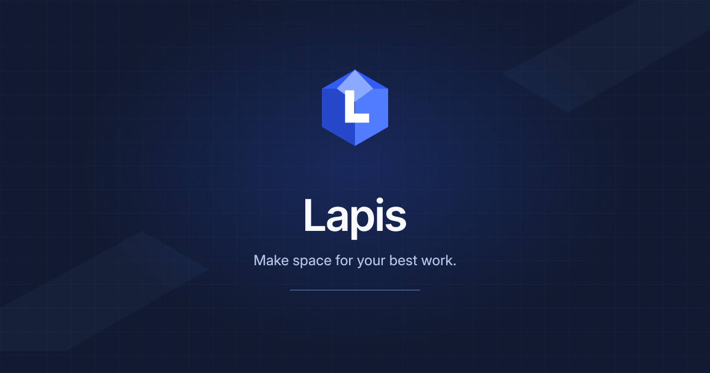

<div align="center">

# Lapis

**Make space for your best work.**

An open-source productivity workspace for notes, plans, databases, and shared knowledge.

[Lapis website](https://yashwanthdevelops.github.io/Lapis/) · Built and maintained by **YashwanthDevelops**

[](./LICENSE)
[](https://nextjs.org)
[](https://react.dev)
[](https://convex.dev)
[](https://tailwindcss.com)

[Documentation](./docs/README.md) ·
[Contributing](./CONTRIBUTING.md) ·
[Security](./SECURITY.md)

</div>



Lapis brings writing, planning, and structured information into one flexible workspace. Use it for personal projects or team knowledge, and choose Convex Cloud or a self-hosted deployment for your backend.

## What you can do

- **Write and organize.** Build pages from rich blocks, nest them, link related notes, and explore connections in the knowledge graph.
- **Work with databases.** Track information in table, board, list, gallery, calendar, feed, timeline, chart, map, form, and dashboard views.
- **Collaborate.** Share pages, invite workspace members, discuss blocks, and review snapshots.
- **Connect your tools.** Use the AI assistant, MCP integrations, webhooks, and Notion-compatible import and export.
- **Keep control.** Run the app with Convex Cloud or self-host the backend with Docker Compose.

## Run Lapis locally

You need Node.js 22 or 24 and Bun 1.4.2 or newer. `bunx convex dev` can run an anonymous local backend; a Convex account is only needed for Convex Cloud.

```bash
bun install
cp .env.example .env.local
# Terminal 1: provision and run the Convex development backend
bunx convex dev
```

In a second terminal, start the Lapis frontend:

```bash
# Terminal 2
bun run dev
```

Convex creates a development deployment and writes its URL into `.env.local`. Open `http://localhost:3000` and create your Lapis account. For Docker hosting, OAuth setup, and production environment variables, see [DEPLOY.md](./DEPLOY.md).

Google Analytics is disabled unless you set your own `NEXT_PUBLIC_GA_ID`. AI features are optional and use the API keys configured in your deployment.

## Project map

- [Project analysis](./docs/project-analysis.md) describes the codebase, current setup, and useful extension points.
- [Architecture diagrams](./docs/architecture/diagrams.md) show the main data and frontend flows.
- [API reference](./docs/api/README.md) documents slices, Convex functions, auth, imports, and integrations.
- [Extension guide](./docs/extending.md) explains how to add blocks, properties, and database views.

## Brand assets

The Lapis mark, wordmarks, icons, and share-card artwork are maintained as SVG sources in `public/brand`. After editing a source asset, regenerate the web formats with:

```bash
bun run generate:brand
```

## About Lapis

Lapis is an open-source productivity workspace created and maintained by YashwanthDevelops. This repository includes MIT-licensed software and preserves original copyright and third-party notices in [LICENSE](./LICENSE) and [NOTICE](./NOTICE).

Lapis is independent of Notion Labs, Inc. and the makers of Obsidian. References to those products describe documented interoperability or familiar concepts; they do not imply endorsement. See [TRADEMARKS.md](./TRADEMARKS.md) and [NOTICE](./NOTICE).

## License

Lapis is distributed under the [MIT License](./LICENSE). See [NOTICE](./NOTICE) for copyright and third-party attribution.
