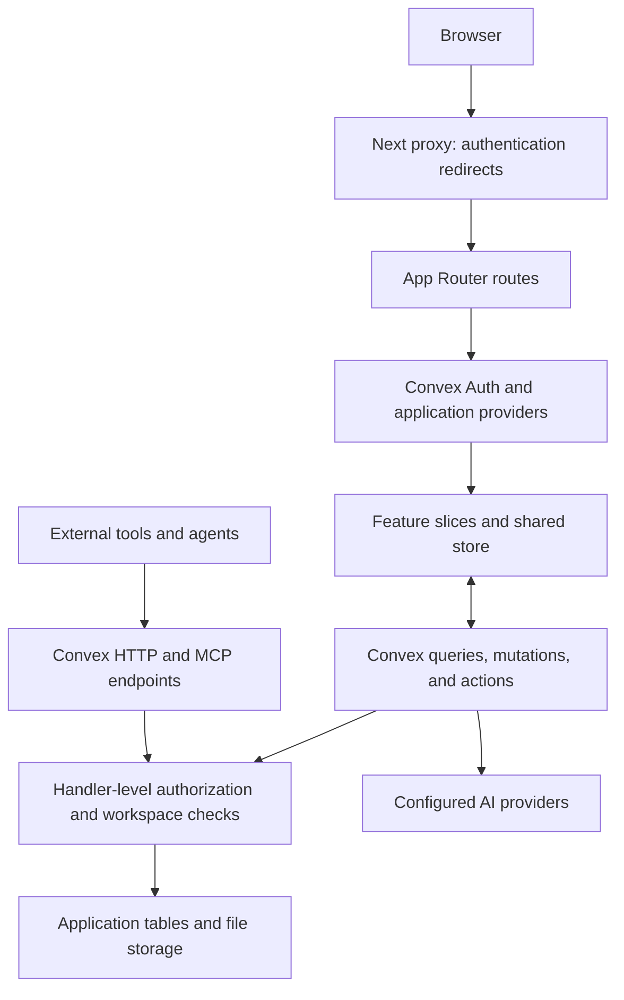

# Project analysis and customization plan

Reviewed on **15 October 2026** for Yashwanth. The selected direction is **a broader productivity app with custom branding and features**. The product is now branded **Lapis**, with a faceted sapphire mark and a blue-and-navy palette. Feature priorities remain to be selected; the changes so far cover the brand and backward-compatible naming migration.

## Download and review scope

- Source: [rahmanef63/open-silong](https://github.com/rahmanef63/open-silong).
- Checkout: `C:\Users\Yashwanth\College\Semester 5\Web Development\Lapis`.
- Snapshot: `3a1b0303bfc65ee02f1ad2be698bda18b545b3ef`, dated 9 September 2026, package version `1.2.0`.
- Full Git clone, including history: 20 commits across the fetched refs; this is not a shallow checkout. There are no declared submodules or Git LFS attributes.
- 1,166 tracked files, 40 frontend feature slices, and 32 explicitly declared application tables plus Convex Auth tables.
- Approximately 101,000 lines across 1,020 TS/TSX/JS/MJS/CSS files, including tests and generated code. There are 90 test files: 58 frontend, 31 backend, and one tooling suite.
- The upstream dependency set was installed successfully: 511 packages, using Bun `1.4.2` through a temporary npm executable. No global Bun installation was needed. The lockfile package name now matches the Lapis package metadata; dependency versions were not changed.

This review covers the upstream baseline architecture, primary entry points and data flows, configuration, customization surfaces, selected implementation risks, and existing documentation. It is not a line-by-line audit of every source file or an authenticated end-to-end test of a deployed instance. The Lapis rebrand has since changed the app metadata, theme, brand assets, customer-facing copy, storage names, and compatible integration identifiers; core dependencies and feature architecture remain based on the upstream snapshot.

## What the app already provides

The project is a substantial workspace foundation. Notes, structured data, and collaboration are already implemented; a customized productivity app can build on them.

| Capability | Implementation | Relevance to our version |
| --- | --- | --- |
| Notes and documents | Block editor, nested blocks, slash menu, inline Markdown, code, equations, files, media, columns | Keep the editor as the writing foundation |
| Structured work | Databases with Table, Board, List, Gallery, Calendar, Feed, Timeline, Chart, Map, Form, and Dashboard views | Reuse for tasks, projects, goals, trackers, and planning |
| Property system | Typed properties, formulas, relations, rollups, filtering, sorting, and grouping | Supports richer productivity workflows without separate implementations for every tracker |
| Knowledge organization | Page tree, library, search, backlinks, mentions, wikilinks, and knowledge graph | Supports a connected personal knowledge base |
| Workspace access | Workspaces, membership, roles, invitations, public sharing, and per-page grants | Supports personal use and optional collaboration |
| Collaboration and recovery | Comments, notifications, presence data, snapshots, trash, and undo/redo | Useful existing infrastructure; simultaneous editing is not CRDT-based |
| Templates | Gallery and seeds for projects, tasks, habits, journaling, courses, budgets, reading, and more | Good starting content for personalized workflows |
| AI | Chat/tool actions, writing assistance, database generation, configurable providers, and user/workspace API keys | Customize behavior and defaults after selecting the intended AI workflows |
| Portability and integrations | JSON workspace import/export, Markdown/CSV/ZIP exports, webhooks, and MCP HTTP/JSON-RPC endpoints | Preserves data portability and provides integration entry points |

The current home screen focuses on creating pages/databases, favorites, recent pages, and database lists. A daily productivity overview would be a meaningful product addition.

## Architecture and data flow

| Layer | Actual code and configuration |
| --- | --- |
| Application framework | Next.js `16.2.12`, App Router, React `19.2.8`, TypeScript |
| Styling | Tailwind `4.3.3`, shadcn/Radix components, theme variables, light/dark modes, preset registry |
| Backend | Convex `1.43.0`, reactive queries, mutations, actions, file storage, and indexed tables |
| Authentication | `@convex-dev/auth`, email/password, anonymous guest support, optional Google OAuth |
| Client state | React context in `frontend/shared/lib/store.tsx`, backed by Convex subscriptions and optimistic mutations |
| Testing | Vitest, jsdom, Testing Library, and convex-test |
| Packaging | Bun package manager; Next standalone output; Node runtime in the Docker image |



Important implementation details:

- `app/layout.tsx` owns global metadata, fonts, root providers, and analytics. The `(app)` route group adds the Convex authentication/realtime stack. Public share/site/form routes have separate rendering paths.
- `app/(app)/dashboard/DashboardShell.tsx` composes the authenticated shell, store, editor/database adapters, sidebar, search, theme bridge, and mobile navigation.
- Feature code lives in `frontend/slices/<name>/`. Shared primitives, domain types, routing, and state live in `frontend/shared/`. Cross-feature integrations should respect the existing barrel exports and adapter boundaries.
- Backend code is partly grouped under `convex/features/`, but many core modules remain at the Convex root or in domain folders such as `convex/ai/`, `convex/templates/`, and `convex/mcp/`. There is no separate Express server.
- Database rows are page records with `rowOfDatabaseId` and `rowProps`. Databases define the property schema and views. New productivity screens should reuse this relationship where practical.
- Page content is stored in `pageBlocks`; `pages` carries metadata and search/preview fields. Use the helpers in `convex/_shared/pageContent.ts` rather than directly treating `pages.blocks` as current content.
- Sidebar/library data uses slim metadata queries; the editor subscribes to full page content separately. Preserve this separation as the app grows.
- Real authorization belongs in Convex handlers. The Next proxy is a navigation gate, not the data-security boundary.

## Where to customize

| Intended change | Main starting points |
| --- | --- |
| Product name, metadata, fonts, social previews | `app/layout.tsx`, auth/setup screens, `public/manifest.webmanifest`, and assets under `public/` |
| Logo and visual identity | `frontend/shared/components/LogoMark.tsx`, `app/globals.css`, `frontend/slices/theme-presets/` |
| Navigation and app structure | `frontend/slices/workspace-sidebar/`, `frontend/slices/mobile-nav/`, dashboard shell, `frontend/shared/lib/routes.ts` |
| Personalized home / Today screen | `frontend/slices/dashboard/views/Dashboard.tsx` and its child components |
| Task/project defaults | `frontend/slices/database-presets/lib/presets.ts`, `convex/templates/seed/` |
| New writing blocks | Shared `BlockType`, `editor/blockSpecs.ts`, renderer registry, placeholder definitions, and relevant serialization/backend validation |
| New database behavior | `frontend/slices/databases/`, shared property metadata/domain types, `convex/databases.ts` and related helpers |
| AI behavior and models | `frontend/slices/ai-agent/`, `frontend/slices/ai-keys/`, `convex/ai/`, `convex/aiKeys/`, `convex/_shared/aiProviders.ts` |
| Onboarding and sample content | `app/(app)/setup/`, `convex/setup.ts`, template seeds, welcome seed helpers |
| Localization and date/time preferences | UI strings across auth/setup/editor/settings plus shared date/format helpers; no centralized translation system was established in this review |

Some legacy identifiers are persisted contracts. The Lapis rebrand migrates old browser preference keys before the app loads, accepts old `nosion://sync/` references and `nsn_` tokens, and sends both Lapis and legacy webhook headers while consumers transition.

## Verified baseline

Host: Windows PowerShell, Node `26.4.0`, Bun `1.4.2`.

| Check | Result |
| --- | --- |
| Frozen dependency installation | Passed; lockfile unchanged |
| Project rule checker | Passed: 0 new violations, 8 waivers, 65 baselined debt entries |
| Frontend and backend TypeScript checks | Passed |
| ESLint | Passed with 0 errors and 210 warnings across 93 files |
| Production build | Passed; compilation, type checking, and generation of 28 static/partially prerendered pages completed |
| Application/backend tests with Node storage workaround | 89 test files passed, 1,188 tests passed, 1 test skipped; the tooling suite failed during module import |
| Tooling suite with temporary loader workaround | All 9 tests passed; no source changes required for this diagnostic run |

The production build used process-local `NEXT_PUBLIC_CONVEX_URL=http://127.0.0.1:3210`, `NEXT_PUBLIC_SITE_URL=http://localhost:3000`, and disabled Next telemetry. These were build placeholders, not a configured or validated backend. No `.env.local` was created, no external backend was provisioned, and no deployment was performed.

Two environment compatibility problems need a permanent resolution before the default Windows test command is a clean gate:

1. **Node 26 storage globals:** the initial run failed 13 AI-session tests because the inherited `localStorage` global was undefined. Running Vitest with process-local `NODE_OPTIONS=--no-experimental-webstorage` lets jsdom supply storage and resolves those failures.
2. **Executable script import:** the Windows checkout uses CRLF (`core.autocrlf=true`). Vite's SSR transformation prepends executable code ahead of the hashbang in `scripts/check-rules.mjs`, causing a syntax error when imported by its tests. Native Node import succeeds. Removing the hashbang in a temporary transform lets all nine tooling tests pass. An LF policy for executable scripts or an appropriate loader/module split should address this without changing the rule logic.

The skipped test documents a real existing issue: `invites.accept` may fail to switch a first-time user's active workspace when their profile has not been created. The matching implementation in `convex/invites.ts` calls `ensurePersonalWorkspace` and then only patches a profile if one exists. Resolve that bootstrap path and enable the test before relying on invitation onboarding.

## Findings to address during customization

These are findings and proposed work, not changes already made.

| Priority | Finding and evidence | Suggested action |
| --- | --- | --- |
| First setup | A real backend and auth configuration are required. `AppProviders` constructs a Convex client from `NEXT_PUBLIC_CONVEX_URL`; this is not a backend-free app. | Configure an instance owned by you, then validate signup, ownership, save/reload, uploads, and sharing. |
| Before publishing | `GoogleAnalytics.tsx` contains the original maintainer's fixed GA measurement ID. Global metadata also contains original branding and a search verification value. `next.config.mjs` retains maintainer-domain fallbacks and legacy redirects. | Make analytics opt-in/configurable and replace identity/origin defaults for this product. |
| Before storing AI keys | `encryptApiKey` in `convex/_shared/aiCrypto.ts` returns plaintext when `AI_KEY_ENCRYPTION_SECRET` is absent or too short. | Configure encryption before saving provider credentials; consider failing closed for new credentials and migrating legacy rows. |
| Before broader password signup | `convex/auth.ts` supplies a custom password implementation: PBKDF2-SHA256 with 10,000 iterations and a legacy `pt_` plaintext-verification branch. | Review and replace/migrate the legacy password path with an intentional password-storage policy. |
| Before collaborative onboarding | Invitation handling has the documented skipped regression described above. | Ensure a profile exists before switching its active workspace and enable the regression test. |
| Development baseline | Package metadata requires Bun `1.4.2`, but CI pins `1.3.14` and Docker build stages use `1.3`; contributor guidance also refers to the older version. | Align package manager versions and instructions. Keep tests on Vitest. |
| Product polish | English is the product's default language. | Keep new interface copy and user-facing errors in English; add localization only when it is an intentional feature. |
| Performance as features grow | Domain hooks still subscribe to one monolithic store context. `store/hooks.ts` explicitly states they do not reduce re-renders. | Split subscriptions/context when measured activity warrants it; do not assume narrower hook names provide isolation. |
| Scale | Admin overview performs eight capped, unindexed scans; some content queries also have explicit scan limits. | Establish expected workspace size and measure before adding aggregate-heavy dashboards. |
| Maintenance | Current checks report 65 rule-debt entries; lint warnings mainly concern `any`, unused variables, hook dependencies, and restricted imports. | Improve touched modules gradually and preserve the measured baseline. |
| Documentation | The AI reference describes an older OpenRouter-only/default-model implementation, while current code has provider selection, BYOK, tool actions, and a different fallback model. | Treat implementation as authoritative and update docs as AI customization proceeds. |

Existing auth/workspace tests provide useful coverage, but these checks do not establish that every endpoint or deployment setting is secure. Authenticated browser flows and external integrations remain unverified until our own backend is configured.

## Suggested product roadmap

The following is a proposed sequence for the selected broader productivity direction. It does not assume specific features have already been approved.

1. **Establish the working base.** Choose cloud/local/self-hosted Convex, configure authentication and instance ownership, align tooling, resolve the two test compatibility issues, and verify core data persistence.
2. **Create the product identity.** Choose the name and visual direction; update branding, icons, metadata, colors, typography, analytics behavior, language, and starter content. Centralize product configuration where repeated strings currently exist.
3. **Build a useful daily home.** Possible elements: today's priorities, overdue tasks, upcoming deadlines, active projects, quick capture, recent notes, and a compact calendar. Base these on existing database/page data and add indexed server queries where needed.
4. **Shape the core workflows.** Reuse task/project presets and template seeds for tasks, projects, notes, goals, habits, and reading. Distinguish a seeded tracker from additional behavior such as recurring tasks, reminders, or automatic progress calculations.
5. **Personalize AI and integrations.** Select the first AI jobs and supported providers; configure key storage and limits; connect integrations only where they serve an agreed workflow.
6. **Polish and release.** Test responsive layouts, keyboard use, editor persistence, backup/restore, workspace isolation, and chosen sharing flows. Configure the production domain and deployment after the customized app is reviewable.

For an initial release, choose three workflows to make excellent. A Today screen, task/project workflow, and connected notes would reuse much of the existing foundation while making the result feel purpose-built.

Offline mode is a separate project: `ServiceWorkerCleanup.tsx` actively unregisters service workers, and the upstream roadmap lists offline/PWA work as unfinished. A manifest or install prompt alone does not provide offline persistence. Collaborative cursors and CRDT editing also require separate decisions rather than being assumed from realtime subscriptions.

## Running the project when the backend choice is made

The local dependency install is complete. Bun can be invoked on this machine without a global install through:

```powershell
npm exec --yes --package=bun@1.4.2 -- bun run typecheck
npm exec --yes --package=bun@1.4.2 -- bun run check:rules
npm exec --yes --package=bun@1.4.2 -- bun run dev
```

For the cloud lane, configure an owned Convex development project with the Convex CLI, populate `.env.local` with its actual frontend endpoint, and configure authentication keys/origin on that backend. Use `scripts/setup-auth.mjs` and `DEPLOY.md` as implementation references after checking the chosen environment. Run the backend development process and Next development server, then complete `/setup` to claim the instance and optionally seed templates.

For self-hosting, the included Compose file defines the Convex backend and dashboard. Its `POSTGRES_URL` points to an externally supplied database: the file does **not** create a Postgres service or include the Next frontend. The frontend Dockerfile is separate, and the configuration needs its own secrets and correct backend/site origins.

The Git remote still points to the original repository. This local download does not create a repository in your GitHub account. When we are ready to publish our changes, choose a fork or a new repository owned by you. Preserve the included `LICENSE` and upstream attribution during customization.

## Decisions needed for the first implementation

- Product name: keep `Lapis` or select another name.
- First three workflows/features, and which existing surfaces should be prominent.
- Visual direction and default language.
- Personal use only or collaboration from the first release.
- Preferred backend/deployment arrangement.

The source, installed dependencies, baseline measurements, and customization map are now available locally for the next iteration.
